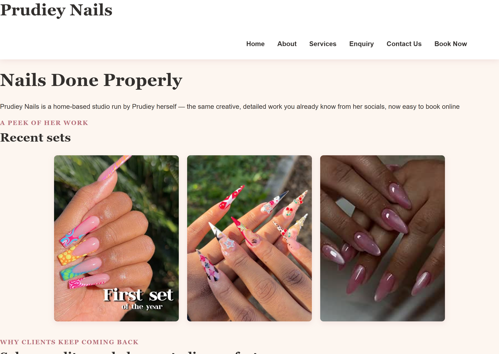
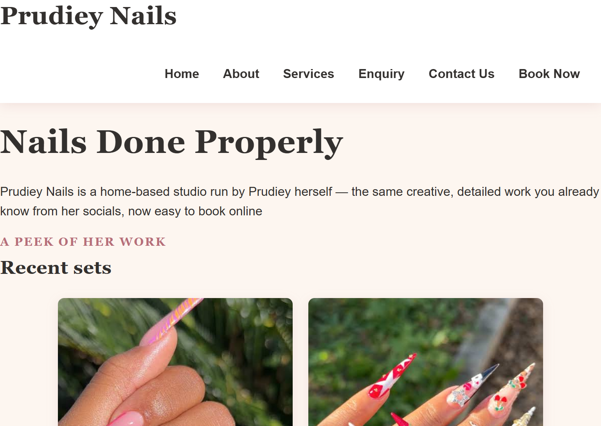
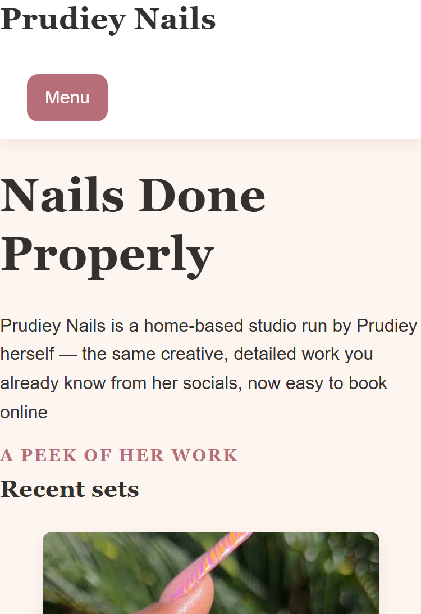

# Website Project: Prudiey Nails

## Student Information
- **Name:** Sinovuyo Magongo
- **Student Number:** ST10481104
- **Course:** WED Development/ WEDE5020
- **Live Link:**https://sinovuyo-magongo.github.io/my-website/

---

## Project Overview
This project is a multi-page business website designed for **Prudie Nails**, a home-based nail salon operating out of Bloemfontein. The purpose of the website is to establish an online presence, showcase nail work, share professional history, and give clients a general idea of service coverage areas.

---

## Goals & Features
- **Professional Brand Presence:** To move from social media only to a dedicated business portfolio website.
- **Client Education:** Clearly explain salon history and operational focus.
- **Location Awareness:** Provide generalized interactive location maps representing the Fichardt Park and Universitas service sectors.
- **Clean Navigation:** An easy-to-use menu linking the structural components together seamlessly.

---

## Part 1 Submission Details
This submission delivers the fundamental layout structure, containing:
- Core folder structuring including `css/`, `images/`, `js/`, and `pages/`.
- Valid content formatting for semantic markup flow.
- Configured file routing structures linking individual core components.

---

## Project Timeline
- **Week 1:** Initialize repository structure and set up local file folders.
- **Week 2:** Create foundational skeleton schemas (`index.html`, `about.html`, `services.html`, `contact.html`).
- **Week 3:** Implement styling parameters, clean up assets, embedded functional content maps.
- **Week 4:** Finalize README documentation layout, test linkages, push verified build to GitHub.

---

## Website Sitemap
- `index.html` (Home / Landing Dashboard)
- `pages/`
  - `about.html` (History, Brand Narrative, Team Showcase)
  - `services.html` (Treatment Information and Catalog Listings)
  - `enquiry.html` (Booking Requests and Intake Communication)
  - `contact.html` (Location Overviews and Social Directories)

---

## Changelog
- **Initial Setup:** Generated foundational empty workspace with initial default `README.md`.
- **Core Update:** Populated folder architectures (`css`, `js`, `images`, `pages`) with active layout documents.
- **Content Expansion:** Drafted internal semantic sections for `about.html` and configured map integrations on `contact.html`.

---

### Part 1 Corrections
- Fixed missing CSS link and script reference on index.html.
- Standardised script.js path across all pages (was inconsistent, causing 404s on some pages).
- Removed invalid stray `<script>` tag inside script.js that broke the file.
- Fixed unclosed `
` in index.html (.recent-sets-section).
- Fixed missing closing `
` for .testimonials-section in about.html, which was collapsing the layout of the follow-section and studio-invite-section below it.
- Fixed broken nested map markup and duplicate closing `</iframe>` tag in contact.html; removed unrelated leftover map embed.
- Fixed dead "Book Now" links pointing to non-existent book.html on index.html, about.html, and services.html; now point to enquiry.html.
- Corrected mismatched image alt text on about.html to accurately describe the images shown.
- Added wireframes for all five site pages (home, about, services, enquiry, contact) — previously missing from Part 1 submission.
- Added inline citations and expanded research evidence across the Target Audience, Website Goals, Current Website Analysis, Design and User Experience, and Technical Requirements sections of the proposal.
- Replaced vague, uncited entries in this README's References section with the full list of sources actually used in research (see References below).

### Part 2 Additions
- Created external stylesheet (css/style.css) linked across all pages.
- Applied base styles, typography (Playfair Display + Lato), and colour scheme (blush pink, rose gold, cream, charcoal).
- Implemented Flexbox/Grid layouts for nav, galleries, service items, and contact details.
- Added hover/focus/active states on buttons, nav links, and service items.
- Added responsive breakpoints at 768px (tablet) and 480px (mobile), with mobile nav toggle.
- Added wireframes for all five site pages (home, about, services, enquiry, contact) — previously missing from Part 1 submission.
- Removed a duplicate, non-responsive `.image-gallery` rule that was overriding the responsive grid layout on smaller screens.
- Added a "Type of message" dropdown to the contact form; the selected type is included in the email subject and body.

### Part 2 Feedback Corrections
- **Feedback received:** "Tablet view media query is required." (Responsive Design: Media Queries/Breakpoints for Tablet and Mobile, 5/10.)
- **Cause:** The responsive rules described in the Part 2 README were not actually present in css/style.css, so the layout did not adapt on tablet or mobile and the mobile menu button was never shown.
- **Fix:** Added a 768px (tablet) and a 480px (mobile) `@media` breakpoint at the bottom of css/style.css. At 768px the Menu button appears, the navigation collapses into a toggled list, the 3-column and 2-column grids reduce, and the map iframes become fluid. At 480px the grids become a single column, headings shrink, and service rows and banner padding are tightened.
- **Related fix:** Removed the `<a>` link wrapped around the Menu button on index.html, which reloaded the home page instead of toggling the menu.

### Part 3 Additions
- Implemented dynamic form processing on enquiry.html: validates input, then displays 
  a response sAdd Part 2 feedback corrections to README changeloghowing the selected service's price and the requested date.
- Implemented email compilation on contact.html: validates input, then builds a mailto: 
  link addressed to hello@prudieynails.co.za with the submitted details pre-filled, 
  allowing the user to review and send the email themselves.
- Added an availability check to the enquiry form response: the requested date is compared against the studio's opening hours (closed Sundays and Mondays) and the user is shown a relevant availability note.
- Added a gallery lightbox to index.html and about.html. Clicking a gallery image opens an enlarged copy in an overlay, built with JavaScript DOM manipulation (script.js) and styled with a CSS fade-in animation (style.css). It closes via the × button, a click outside the image, or the Escape key.
- Replaced the browser's default validation popups on enquiry.html and contact.html with JavaScript validation (script.js). Each field is checked on submit (required fields, name format, South African phone number format, email format, past dates, minimum message length) and a specific error message is displayed under any invalid field, with the cursor moved to the first error. Messages clear as the user corrects the field. Error styling added in style.css.
- Added AJAX submission to the enquiry form (script.js). After validation passes, the enquiry is sent in the background to a Formspree endpoint using `fetch` (no page reload). The button shows "Sending..." and is disabled while the request runs; on success the price and availability summary is shown with a confirmation, and on failure an error message with the studio's WhatsApp number is displayed instead.
- Added search, category filter and price sort to services.html (script.js, style.css). The controls are created with JavaScript and operate on the existing service cards: typing filters cards by name, description or price, the category dropdown (built from the page's own headings) shows one category at a time, and the sort option orders each category by price (including "from" prices). A live result count and a "no services match" message are displayed. services.html itself was not changed.
- Added a service details modal to services.html (script.js, style.css). Clicking or pressing Enter on a service card opens a popup built from the card's own name, description and price, with a "Book this service" button. The modal closes with the × button, a click outside, or Escape, keeps keyboard focus inside while open, and returns focus to the card afterwards. The button links to enquiry.html with the service name in the URL, and script.js pre-selects the matching option in the enquiry form's service dropdown.
- Added an interactive map to contact.html using the Leaflet library with OpenStreetMap tiles (contact.html, script.js, style.css). Two circles mark the Fichardt Park and Universitas service areas, using general areas rather than exact points to protect the studio's privacy. Clicking a circle opens a popup, and buttons fly the map to each area or back to both. One-finger dragging is disabled on touch devices so the page remains scrollable, the map is hidden if Leaflet fails to load, and the existing Google Maps embeds remain as a fallback.
- Added robots.txt (allows all pages, links to the sitemap) and sitemap.xml (lists all five pages with priorities and last-modified dates) in the repository root. Note: because the site is hosted in a /my-website/ sub-folder on GitHub Pages, search engines only read robots.txt from the domain root, so the sitemap is the more effective of the two.
- Added `loading="lazy"` to the three images on about.html so they load only as the visitor scrolls, improving page speed.

## Part 3 Features: Enhancing Functionality and SEO

| Feature | Page(s) | Files |
|---|---|---|
| Gallery lightbox (click to enlarge, Esc to close) | index.html, about.html | js/script.js, css/style.css |
| JavaScript form validation with inline error messages | enquiry.html, contact.html | js/script.js, css/style.css |
| Enquiry response showing price and availability | enquiry.html | js/script.js |
| AJAX enquiry submission (Formspree, no page reload) | enquiry.html | js/script.js |
| Email compiled from the contact form (mailto) | contact.html | js/script.js |
| Services search, category filter and price sort | services.html | js/script.js, css/style.css |
| Service details modal with "Book this service" link | services.html, enquiry.html | js/script.js, css/style.css |
| Interactive service-area map (Leaflet + OpenStreetMap) | contact.html | pages/contact.html, js/script.js, css/style.css |
| SEO: titles, meta descriptions, meta keywords, alt text, image names, robots.txt, sitemap.xml | all pages | all HTML files, images/, robots.txt, sitemap.xml |

**Third-party tools used:** Leaflet (maps), OpenStreetMap (map tiles) and Formspree (receives enquiry submissions on the static GitHub Pages host).

**Deployment:** The site is deployed on GitHub Pages: https://sinovuyo-magongo.github.io/my-website/

## Wireframes

### Home

### About

### Services

### Enquiry

### Contact

## Responsive Design Evidence

## Desktop View

## Tablet View

## Mobile View

## References
- LeadsuiteNow (2026) *Nail salon lead generation & client retention USA: 2026 guide*. Available at: https://leadsuitenow.com/blog/nail-salon-lead-generation-usa-2026 (Accessed: 12 September 2026).
- MioSalon (2025) *Top benefits of online booking for salons to boost revenue*. Available at: https://blog.miosalon.com/surprising-benefits-of-online-booking-for-salons-when-done-right/ (Accessed: 5 August 2026).
- Pagecloud (2024) *Top website goals to grow online and how to achieve them*. Available at: https://www.pagecloud.com/blog/website-goals-and-how-to-achieve-them (Accessed: 5 August 2026).
- RegisterDomain.co.za (2026) *Domain registration in South Africa: costs and considerations*. Available at: https://www.registerdomain.co.za/blog/domain-registration-south-africa/ (Accessed: 5 August 2026).
- Salon Booking System (2026) *Nail salon booking app: complete guide for 2026*. Available at: https://www.salonbookingsystem.com/salon-booking-system-blog/nail-salon-booking-app/ (Accessed: 12 September 2026).
- Studio Mesa (2026) *Website goals for small business: setting measurable objectives that drive growth*. Available at: https://studiomesa.co/articles/website-goals-for-small-business-measurable-objectives/ (Accessed: 5 August 2026).
- UXPin (2026) *Mobile-first design: a complete guide with examples and best practices*. Available at: https://www.uxpin.com/studio/blog/a-hands-on-guide-to-mobile-first-design/ (Accessed: 5 August 2026).
- Zenoti (2026) *2026 nail salon trends every business owner should know*. Available at: https://www.zenoti.com/thecheckin/2026-nail-salon-trends (Accessed: 12 September 2026).
- Leaflet (2023) *Leaflet: an open-source JavaScript library for mobile-friendly interactive maps*. Available at: https://leafletjs.com/ (Accessed: 31 October 2026).
- OpenStreetMap contributors (2026) *OpenStreetMap copyright and licence*. Available at: https://www.openstreetmap.org/copyright (Accessed: 31 October 2026).

